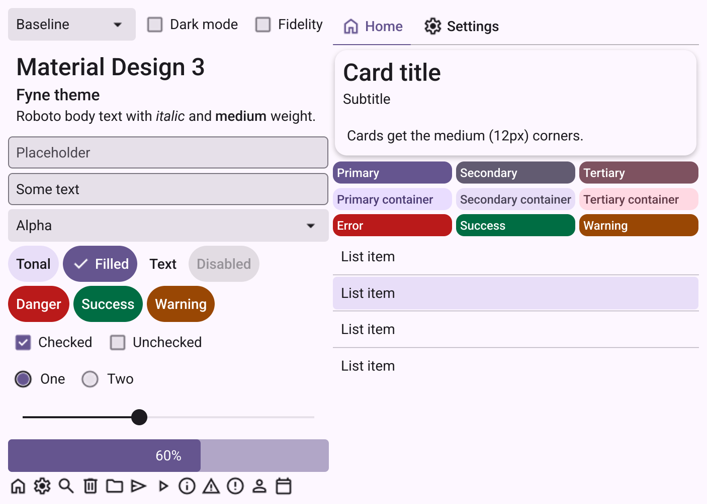
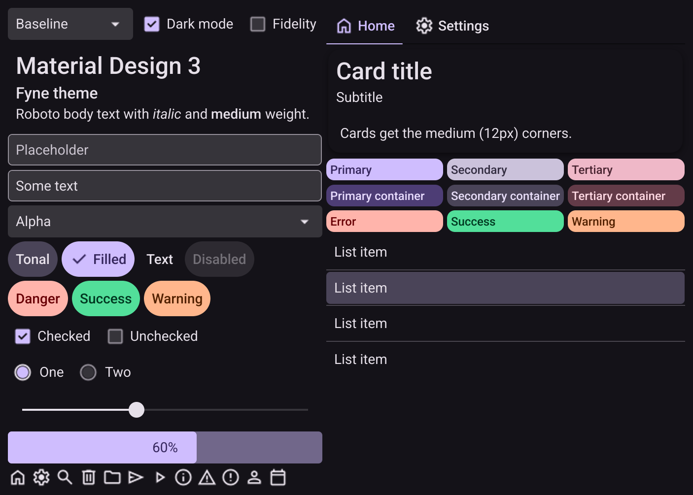
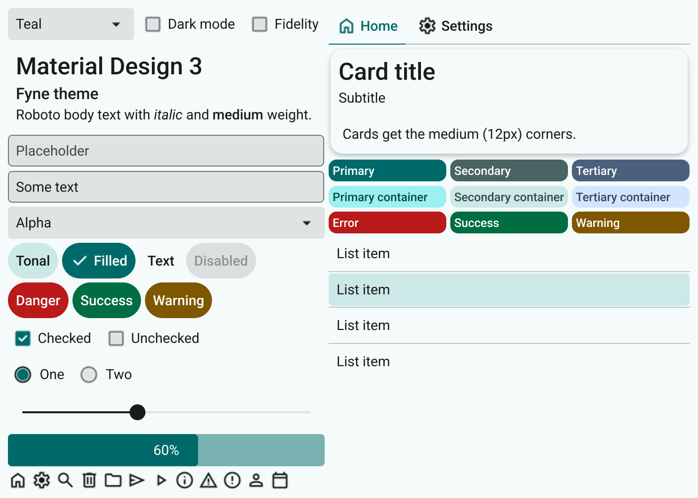
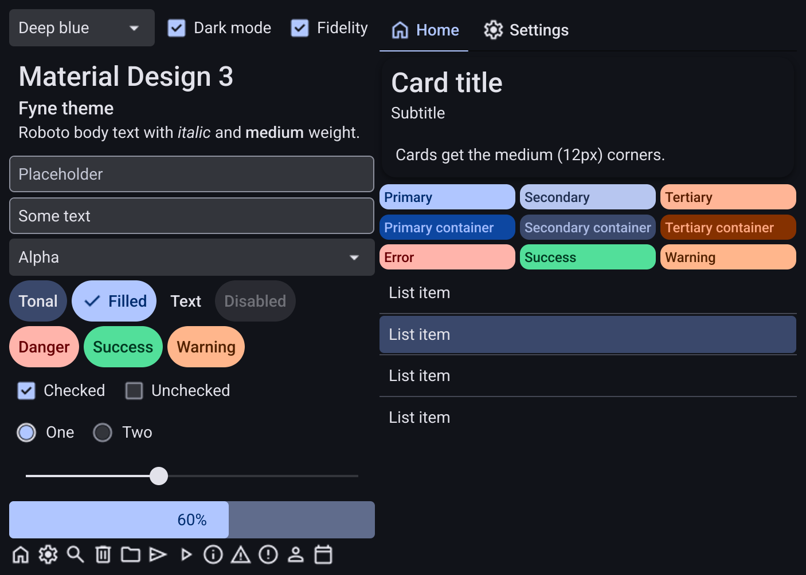

# mdi3

Material Design 3 theme for [Fyne](https://fyne.io) v2.8.2.

Give it one seed color and it generates the full M3 light and dark schemes from it, same algorithm as Google's Material Theme Builder (HCT, tonal spot). Roboto, the M3 type and shape scales and Material Symbols icons are all embedded, nothing extra to ship.

<p>




</p>

## Demo

```
go run github.com/roffe/mdi3/example@latest
```

Pick a seed color, flip dark mode or the fidelity scheme and watch the whole thing regenerate. The screenshots above come from the same demo, `go test ./example -update` renders them again.

## Install

```
go get github.com/roffe/mdi3
```

## Usage

```go
a := app.New()
a.Settings().SetTheme(mdi3.New(nil))
```

`nil` gives you the M3 baseline purple (#6750A4). Pass any color to use your own:

```go
a.Settings().SetTheme(mdi3.New(color.NRGBA{R: 0x00, G: 0x6a, B: 0x6a, A: 0xff}))
```

## Tonal spot or fidelity

`New` is M3's default "tonal spot" scheme. It only uses the hue of your seed, saturation and lightness are thrown away, so every seed gets the same calm M3 look. #1565C0, #0D47A1 and #003F88 all end up as pretty much the same dusty blue.

If you want your brand color to actually show, use `NewFidelity`:

```go
a.Settings().SetTheme(mdi3.NewFidelity(color.NRGBA{R: 0x15, G: 0x65, B: 0xc0, A: 0xff}))
```

It keeps the seed's chroma, the seed itself becomes the primary container and tertiary is picked as the seed's warm/cold complement. Primary is kept at least 10 tones darker than the container in light mode (lighter in dark mode) so they don't blend together. So a dark seed gives an even darker primary, #0D47A1 gives #003178. For a deep blue primary around #0D47A1 use #1565C0 as seed, that lands on #004D99.

## Light and dark

Light or dark follows the user's preference just like the built in Fyne theme. Both schemes are generated once in `New`, after that every color lookup is a map read.

All stock Fyne widgets pick it up as is. Buttons are pill shaped tonal buttons, `HighImportance` is filled primary, dialogs get the 28px M3 corners, cards 12px and so on.

## Color roles

Every M3 color role is exported as a `fyne.ThemeColorName` so you can use them in your own widgets:

```go
bg := canvas.NewRectangle(theme.Color(mdi3.ColorNamePrimaryContainer))
txt := canvas.NewText("Hello", theme.Color(mdi3.ColorNameOnPrimaryContainer))
```

Where Fyne already has a name for the role you use Fyne's: `theme.ColorNamePrimary`, `theme.ColorNameError`, `theme.ColorNameSuccess` and `theme.ColorNameWarning`. `theme.ColorNameBackground` is the same as `mdi3.ColorNameSurface`.

Success and warning are M3 custom colors, harmonized toward your seed so they don't clash with it. They have containers too: `ColorNameSuccessContainer`, `ColorNameOnSuccessContainer`, `ColorNameWarningContainer` and `ColorNameOnWarningContainer`.

This is how Fyne's own names map to M3:

| Fyne | M3 |
|---|---|
| Background | surface |
| Foreground | onSurface |
| Button | secondaryContainer (tonal button) |
| Selection | secondaryContainer |
| InputBackground | surfaceContainerHighest |
| InputBorder | outline |
| MenuBackground | surfaceContainer |
| OverlayBackground | surfaceContainerHigh |
| HeaderBackground | surfaceContainer |
| PlaceHolder | onSurfaceVariant |
| Separator | outlineVariant |
| Hover / Pressed | onSurface at 8% / 10% |
| Focus | primary at 16% |
| Disabled / DisabledButton | onSurface at 38% / 12% |

## Typography

Text is Roboto. Fyne's bold maps to Roboto Medium since that's the weight M3 uses for titles, labels and buttons. Monospace and symbol stay on Fyne's fonts.

Text is 14 (body medium), headings 24 (headline small), sub headings 16 (title medium) and captions 12 (body small). The full type scale is there as size names:

```go
title := canvas.NewText("Settings", theme.Color(mdi3.ColorNameOnSurface))
title.TextSize = theme.Size(mdi3.SizeNameTitleLarge)
```

`SizeNameDisplayLarge/Medium/Small`, `SizeNameHeadlineLarge/Medium/Small`, `SizeNameTitleLarge/Medium/Small`, `SizeNameBodyLarge/Medium/Small` and `SizeNameLabelLarge/Medium/Small`.

## Shape

Same deal for the corner radius scale:

```go
card := canvas.NewRectangle(theme.Color(mdi3.ColorNameSurfaceContainerLow))
card.CornerRadius = theme.Size(mdi3.SizeNameCornerLarge)
```

`SizeNameCornerExtraSmall` 4, `Small` 8, `Medium` 12, `Large` 16, `LargeIncreased` 20, `ExtraLarge` 28, `ExtraLargeIncreased` 32, `ExtraExtraLarge` 48 and `Full`.

## Icons

Fyne's theme icons are swapped for Material Symbols Outlined (weight 400, 24px) and tinted with the foreground color like the stock ones. The few with no Symbols equivalent (check/radio fills, color swatches, drag corner, file application) stay as Fyne's own.

To change or add one, edit the `mapping` table in `gen.go` and run

```
go generate
```

It downloads any missing SVG from Google Fonts into `icons/` and regenerates `icons.go`, one `//go:embed` per icon and a static switch for the lookup.

Need icons outside the theme set? Use [roffe/mdi](https://github.com/roffe/mdi), it has all ~7400 of them.

## Tweaking

The theme is a plain `fyne.Theme` so you can wrap it and override whatever you like. Out of the box buttons are 36px high, M3 says 40. If you want the real M3 size bump the inner padding to 10:

```go
type m3Size struct{ fyne.Theme }

func (t m3Size) Size(n fyne.ThemeSizeName) float32 {
	if n == theme.SizeNameInnerPadding {
		return 10
	}
	return t.Theme.Size(n)
}

a.Settings().SetTheme(m3Size{mdi3.New(nil)})
```

That makes entries, labels and list rows 4px taller too, which is why it's not the default.

## Known limits

- Slider thumb and active track are always the foreground color. That's hardcoded in Fyne's slider, the theme can't make it primary.
- Fyne can't draw the M3 focus ring, so the focus highlight is 16% instead of 10% to stay visible.
- Standard contrast only, no medium/high contrast schemes.
- The seed is what you pass to `New`, the primary color picked in Fyne's settings app is not used.

## Licenses

Roboto is under the SIL Open Font License, see `fonts/OFL.txt`. Material Symbols and the HCT color code (ported from Google's [material-color-utilities](https://github.com/material-foundation/material-color-utilities)) are Apache 2.0.
